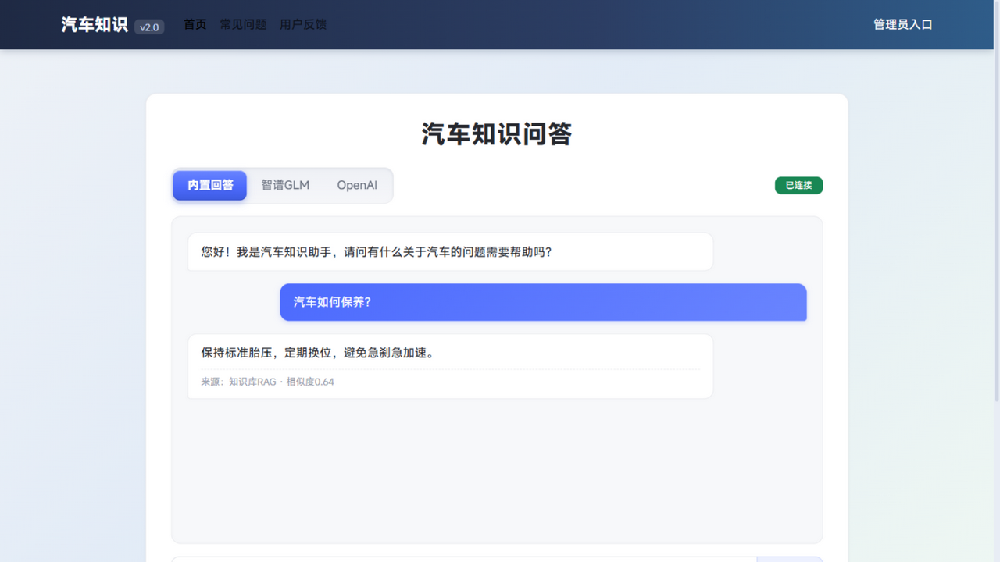
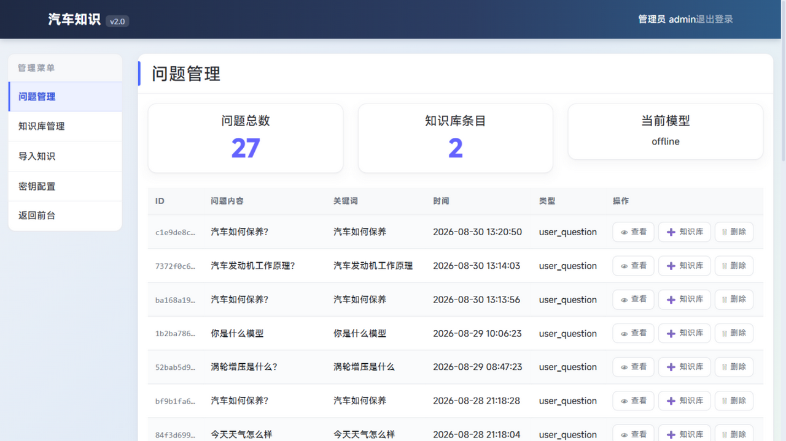

# 汽车知识问答系统 v2.0

基于 Flask 的汽车领域知识问答系统，支持 **bge-m3 向量 RAG 检索回答**、大模型 API 接入（智谱 GLM / OpenAI，界面直接配 Key）、问答记录管理、知识库管理与多格式导入、用户反馈入库、管理后台登录鉴权。界面采用 DeepSeek 风格设计语言（#4D6BFE 品牌蓝紫 + 白色面板 + 渐变点缀）。

## 界面预览

**前台问答**（bge-m3 RAG 语义检索，回答底部标注来源与相似度）：



**管理后台**（问题管理 / 浅色按钮家族 / 侧边栏当前页高亮 / SPA 无刷新切换）：



## 项目架构

```
汽车知识问答系统代码v2.0/
├── README.md                   # 本文档
├── app.py                      # Flask 主程序（路由 / 数据库 / 问答逻辑 / RAG / 大模型调用）
├── rag.py                      # RAG 检索模块（本地 bge-m3 嵌入 + 余弦相似度，带向量缓存）
├── check_files.py              # 项目文件完整性检查脚本（辅助工具）
├── data/
│   ├── knowledge_qa.db         # SQLite 数据库（首次启动自动创建）
│   ├── .secret_key             # 会话密钥（首次启动自动生成，请勿删除）
│   ├── knowledge_base.json     # 旧版 JSON 数据（首次启动自动迁移到 SQLite）
│   └── questions.json          # 旧版 JSON 数据
├── templates/
│   ├── login.html              # 登录页（管理后台入口）
│   ├── index.html              # 首页：问答聊天界面 + 模型选择
│   ├── admin.html              # 管理后台：问题记录、统计、删除
│   ├── knowledge.html          # 知识库管理：搜索 / 添加 / 编辑 / 删除 / 清空 / 导出
│   ├── upload_knowledge.html   # 知识导入：文本导入（JSON/TXT/CSV/MD）+ 文件上传
│   ├── api_keys.html           # API密钥配置页（界面填写智谱/OpenAI密钥）
│   ├── faq.html                # 常见问题页
│   └── feedback.html           # 用户反馈页（可勾选将反馈加入知识库）
├── static/css/style.css        # 全站样式（DeepSeek 风格设计系统，CSS 变量统一管理）
└── login.html / dashboard.html # （根目录下）早期静态设计稿，未接入后端，仅供参考
```

> 注意：仓库中存在两层结构 —— 实际可运行的完整代码在 `汽车知识问答系统代码/` 子目录内；根目录下的 `login.html`、`dashboard.html` 和外层 `data/` 是早期设计稿，运行不依赖它们。

### 架构示意

```
浏览器 (templates + Bootstrap CDN)
   │  GET 页面 / fetch + form 提交
   ▼
Flask app.py
   ├── 公开页面：/  /faq  /feedback  /login
   ├── 管理页面（需登录）：/admin  /knowledge  /upload_knowledge
   ├── 公开 API：/ask  /api_status  /check_model  /submit_feedback
   └── 管理 API（需登录）：/add_knowledge  /get_knowledge/<id>
                           /update_knowledge/<id>  /delete_knowledge/<id>
                           /delete_question/<id>  /clear_knowledge_base
                           /export_knowledge  /import_knowledge_text
                           /upload_knowledge_file
   │
   ▼  get_answer()  —— 回答策略（按优先级）
   1. RAG 语义检索（rag.py）：bge-m3 向量化，余弦相似度 ≥0.55 直接命中
   2. 关键词匹配兜底（SQLite）：精确 → 双向包含 → 关键词命中
   3. offline：内置关键词规则回答（开箱即用）
   4. zhipu / openai：调用 OpenAI 兼容接口 + RAG 检索结果注入上下文
   │
   ▼  SQLite（data/knowledge_qa.db）
   knowledge（知识条目）/ questions（提问记录）
   feedback（用户反馈）/ import_logs（导入日志）
```

### 回答优先级

1. **RAG 语义检索**：`rag.py` 用本地 bge-m3 模型把知识条目与用户问题都编码成向量，余弦相似度最高的条目 ≥0.55 时直接返回该答案（支持"问法不同但意思相同"的命中）；
2. **关键词匹配兜底**：嵌入模型不可用时自动回退到精确/包含/关键词匹配；
3. **内置回答（offline）**：知识库未命中时按关键词规则返回内置答案，无需任何配置；
4. **大模型 + RAG 增强**：选择 zhipu / openai 模式时，调用 OpenAI 兼容的 `chat/completions` 接口，并把检索到的前 3 条相关知识注入 system prompt 作为参考资料。

## RAG 语义检索说明

- **模型**：本地 bge-m3 嵌入模型（1024 维），默认路径 `D:\尚硅谷day01\资料\LangChain_Day01\2.资料\bge-m3`，可通过环境变量 `BGE_M3_PATH` 覆盖；
- **向量缓存**：每条知识的向量按内容签名缓存在内存中，只有新增/修改过的条目才重新编码，知识库不变时检索耗时约 0.1 秒；
- **首次加载**：模型加载约需 15 秒（CPU），发生在第一次提问时，之后不再重复加载；
- **优雅降级**：模型目录不存在或依赖缺失时，`rag_search` 返回 None，系统自动回退到关键词匹配，功能不受影响；
- **依赖**：需要 `sentence-transformers` 与 `torch`（CPU 版即可），见下方运行方式。

## 运行方式

环境要求：Python 3.8+。基础依赖 `flask`、`requests`；如需启用 RAG 语义检索，另装向量模型依赖（CPU 版 torch 即可）。

```bash
cd 汽车知识问答系统代码
pip install flask requests
# 可选：启用 RAG 语义检索（约 2GB，含 CPU 版 torch）
pip install sentence-transformers torch --index-url https://download.pytorch.org/whl/cpu
python app.py
```

启动后访问 http://127.0.0.1:5000/ 进入问答首页。

- 管理后台入口 `/admin`，默认账号 `admin / admin123`；
- 可通过环境变量 `ADMIN_USERNAME` / `ADMIN_PASSWORD` 修改管理员账号；
- 运行模式为 `debug=True`，修改代码会自动重载；生产部署请关闭 debug。

### 配置（环境变量）

| 变量 | 说明 | 默认值 |
|---|---|---|
| `ADMIN_USERNAME` / `ADMIN_PASSWORD` | 管理后台账号 | admin / admin123 |
| `OPENAI_API_KEY` | OpenAI 密钥，配置后首页可选 OpenAI 模型 | 空（未配置显示未连接） |
| `OPENAI_API_URL` / `OPENAI_MODEL` | OpenAI 接口地址 / 模型名 | 官方地址 / gpt-3.5-turbo |
| `ZHIPU_API_KEY` | 智谱 GLM 密钥（https://open.bigmodel.cn 获取），配置后可选智谱GLM模型 | 空 |
| `ZHIPU_API_URL` / `ZHIPU_MODEL` | 智谱接口地址 / 模型名 | open.bigmodel.cn/api/paas/v4 / glm-4.5-air |
| `BGE_M3_PATH` | RAG 嵌入模型（bge-m3）本地目录 | D:\尚硅谷day01\资料\...\bge-m3 |

密钥也可以不用环境变量：登录管理后台后进入 **「API密钥配置」** 页面（`/api_keys`），直接粘贴保存即可，立即生效无需重启（保存在 SQLite 的 settings 表中，界面配置优先于环境变量；输入框留空提交可清除已保存的密钥）。

两个 API 均为 OpenAI 兼容格式，也可指向其他兼容服务（如本地 Ollama、one-api 等）。未配置密钥时选择对应模型，前端状态角标会显示"未连接"，提问会返回友好提示。

## 功能说明

- **问答**：首页聊天界面，支持快速问题；每次提问自动记录到数据库（时间 / 使用的模型 / 关键词）。
- **知识库管理**：增删改查、按问题/答案/关键词搜索、一键清空、导出为 JSON 文件。
- **知识导入**：支持直接粘贴文本和上传文件，两种方式均支持 JSON、TXT（每三行一组）、CSV、Markdown（`##` 标题为问题）四种格式，导入操作记录到导入日志。
- **用户反馈**：提交反馈存入数据库；勾选"添加到知识库"后，反馈内容会作为知识条目直接生效。
- **管理后台**：查看/删除提问记录、统计信息；所有管理页面与接口均需登录。

## 数据存储

- 使用 SQLite（标准库自带，单文件 `data/knowledge_qa.db`），每次请求独立连接，避免并发写坏文件；
- 首次启动时自动建表，并把旧版 `data/*.json` 中的数据一次性迁移进数据库（迁移后旧文件保留不动）；
- 会话密钥首次启动生成并保存到 `data/.secret_key`，重启后已登录状态不失效。

## 界面风格

全站采用 DeepSeek 风格设计语言，配色与质感由 `static/css/style.css` 顶部的 CSS 变量统一管理：

- **品牌色**：#4D6BFE 蓝紫（悬停 #3E5BEA，浅底 #ECF0FF），语义色绿/黄/红均为低饱和渐变色块；
- **页面背景**：淡蓝灰渐变（135°，#eef2f7 → #e3ecf7 → #eef7f3），内容承载于白色圆角面板；
- **首页模型选择器**：分段式滑动色块，点击选项时蓝色色块平滑滑动到当前项，右侧状态角标实时联动；
- **管理后台**：侧边栏当前菜单蓝色渐变高亮、标题左侧品牌色竖条、统计数字渐变文字、表格行悬停浅蓝、操作按钮为图标胶囊式（查看/编辑/知识库/删除按功能着色）；
- **登录页**：渐变背景 + 顶部品牌色光条卡片。

## 仍可继续优化的方向

1. **向量持久化**：RAG 向量缓存目前在内存中（重启需重建），可落库到 SQLite 或引入 FAISS；知识库规模大后可改批量编码与 ANN 索引；
2. **前端工程化**：各模板导航栏重复，可抽 `base.html` 模板继承；Bootstrap 走 CDN，离线环境演示会缺样式，建议静态资源本地化；
3. **安全增强**：登录接口可加验证码 / CSRF 防护；管理员密码目前明文存环境变量，可改哈希存储；API 密钥界面保存的是明文，可加密存储；
4. **部署**：生产环境用 `waitress` / `gunicorn` 替代 Flask 开发服务器。

## 技术栈

Flask 3 + Jinja2 + SQLite（标准库 sqlite3）+ Bootstrap 5（CDN）+ sentence-transformers（bge-m3 嵌入，RAG 检索）+ requests（OpenAI 兼容大模型 API）。
